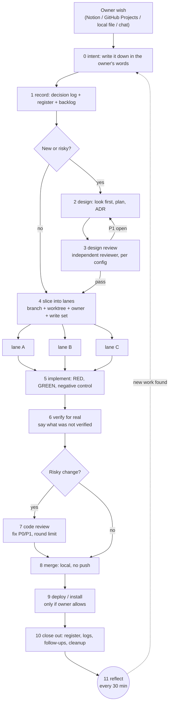
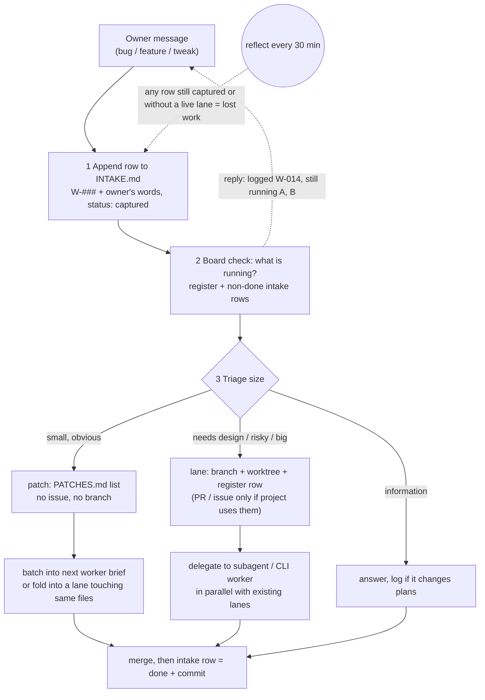
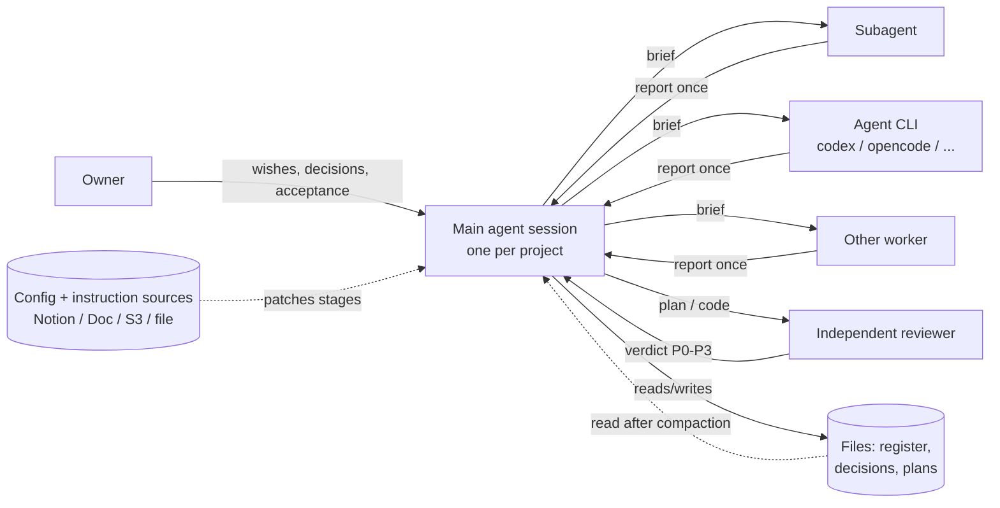

# Diagrams

## The loop



## Intake: every chat request is captured first



## Who does what



## Where things live

```text
 Owner's chat / AI ──► INBOX (Notion DB | GitHub Projects | docs/backlog/INDEX.md)
                              │ accepted
                              ▼
  RESEARCH STORE ◄─ symlink ─ references/   (not in git)    docs/research/  (public-safe evidence)
  (Google Drive: discussions,                                      │
   concept pictures)                                                ▼
                         docs/decisions/  ──►  docs/plans/ + docs/adr/  ──►  code lanes
                                 │                    │                          │
                                 └────────────────────┴───► WORK-REGISTER.md ◄──┘
                                                      review-followups.md, .journal/
```
